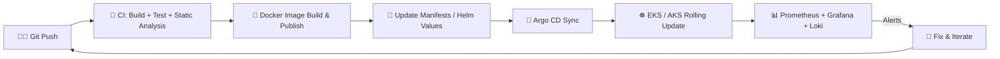
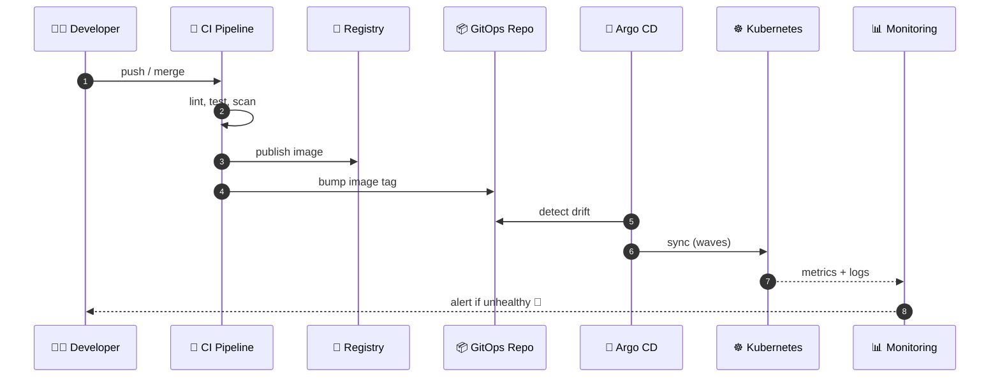
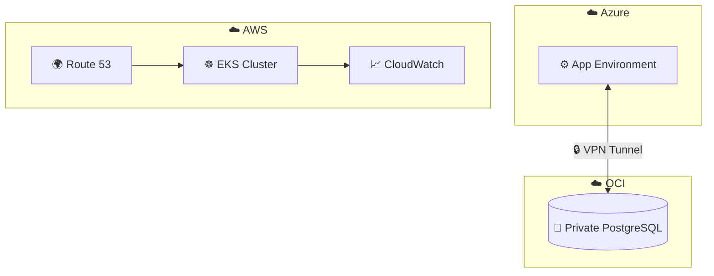

<div align="center">


<a href="https://github.com/yogesh-softradix">
  
</a>

<br/><br/>

[](https://github.com/yogesh-softradix)
[](mailto:its.yogesh.23@gmail.com)

</div>

---

## 🖥️ `whoami`

```bash
$ whoami
yogesh-sharma

$ cat /etc/profile
role        : DevOps Engineer
focus       : Cloud | Kubernetes | CI/CD | GitOps | IaC
clouds      : AWS, OCI, Azure-connected environments
mission     : Automate deployments. Improve reliability. Reduce toil.
status      : always learning, always shipping 🚀

$ kubectl get pods -n yogesh
NAME                 READY   STATUS    RESTARTS   AGE
curiosity-7d9f8c     1/1     Running   0          ∞
automation-5b6c4d    1/1     Running   0          ∞
coffee-0             1/1     Running   0          ∞
```

I build automated deployment workflows, manage cloud infrastructure, and improve application reliability through containerization, GitOps, and observability.

---

## ⚡ What I Do

<table>
<tr>
<td width="50%" valign="top">

### ☁️ Cloud & Infra
Provisioning and managing infrastructure on **AWS**, **OCI** and Azure-connected setups, from VPCs and subnets to EKS clusters and managed databases.

</td>
<td width="50%" valign="top">

### 📦 Containers & K8s
Containerizing apps with optimized multi-stage Dockerfiles and running them on **EKS** and **AKS** with **Helm**.

</td>
</tr>
<tr>
<td width="50%" valign="top">

### 🔄 CI/CD & GitOps
Automated build, test and deploy pipelines with **GitHub Actions**, **GitLab CI**, **Jenkins** and **Argo CD**.

</td>
<td width="50%" valign="top">

### 📊 Observability
Dashboards, logs and alerts with **Prometheus**, **Grafana**, **Loki**, **Alloy** and **CloudWatch**.

</td>
</tr>
</table>

---

## 🧰 Tech Arsenal

<div align="center">


<br/>
&nbsp;&nbsp;
&nbsp;&nbsp;
&nbsp;&nbsp;

<br/>


</div>

<br/>

| Area | Technologies |
|---|---|
| ☁️ **Cloud Platforms** | AWS (EC2, EKS, S3, IAM, CloudWatch, VPC, Route 53), Oracle Cloud Infrastructure (OCI) |
| ☸️ **Containers & Orchestration** | Docker, Kubernetes, Amazon EKS, Azure AKS, Helm |
| 🔄 **CI/CD & GitOps** | GitHub Actions, GitLab CI, Jenkins, Argo CD |
| 🏗️ **Infrastructure as Code** | Terraform |
| 🌐 **Web Servers & Process Mgmt** | Nginx, Apache, PM2 |
| 📊 **Monitoring & Logging** | Prometheus, Grafana, Loki, Grafana Alloy, Promtail, CloudWatch |
| 🗄️ **Databases** | MySQL, PostgreSQL, Amazon RDS |
| 🧬 **Version Control** | Git, GitHub, GitLab |
| 🐧 **Scripting & Systems** | Linux, Bash, server administration, networking, DNS, SSL/TLS |

---

## 🔁 How I Ship: Delivery Flow



### 🔬 What happens on a deploy



---

## 🧱 Architecture Patterns I Work With



---

## 🚀 Projects & Hands-on Work

<details open>
<summary><b>☸️ Containerization & Kubernetes</b></summary>
<br/>

- Containerized **Node.js, Python, and React** applications using optimized Dockerfiles and multi-stage builds.
- Worked with Kubernetes **Deployments, Services, Ingress, ConfigMaps, Secrets, and autoscaling**.
- Deployed workloads to **EKS and AKS** environments.

</details>

<details open>
<summary><b>🔄 CI/CD Pipeline Automation</b></summary>
<br/>

- Built and maintained pipelines with **GitHub Actions** and **GitLab CI** for automated build, test, and deployment.
- Worked with GitHub-hosted and **self-hosted runners**.
- Integrated static code analysis, unit testing, and Docker image publishing into pipelines.
- Created **Jenkins** pipelines for staging and production deployments, including rolling updates.

</details>

<details open>
<summary><b>🏗️ Terraform & Cloud Infrastructure</b></summary>
<br/>

- Provisioned cloud infrastructure and **EKS clusters** with modular Infrastructure as Code practices.
- Worked with compute instances, storage, networking, subnets, and cloud database resources.
- Set up **secure cross-cloud connectivity** between a private PostgreSQL database on OCI and an Azure environment through a **VPN tunnel**.

</details>

<details open>
<summary><b>🔀 Argo CD & GitOps</b></summary>
<br/>

- Set up declarative, Git-based deployment workflows for Kubernetes environments.
- Worked with Argo CD **sync waves, project RBAC, and automated image updates**.

</details>

<details open>
<summary><b>📊 Monitoring & Observability</b></summary>
<br/>

- Built monitoring and logging stacks using **Prometheus, Grafana, Loki, and Promtail**.
- Created dashboards for application performance, server metrics, logs, and deployment health.
- Configured alerts for resource spikes, pod failures, and deployment issues.

</details>

<details open>
<summary><b>🌐 Website Hosting & Reverse Proxy</b></summary>
<br/>

- Hosted WordPress and custom web applications using **Apache and Nginx**.
- Deployed Node.js applications with Apache ProxyPass and **PM2**.
- Configured SSL certificates with **Certbot** and automated server tasks with **Bash scripts**.

</details>

---

## 🧪 Code Snippets I Like (Reference Patterns)

<details>
<summary><b>🐳 Multi-stage Dockerfile (Node.js)</b></summary>

```dockerfile
# ---- build stage ----
FROM node:20-alpine AS build
WORKDIR /app
COPY package*.json ./
RUN npm ci
COPY . .
RUN npm run build

# ---- runtime stage ----
FROM node:20-alpine
WORKDIR /app
ENV NODE_ENV=production
COPY --from=build /app/dist ./dist
COPY --from=build /app/package*.json ./
RUN npm ci --omit=dev && npm cache clean --force
USER node
EXPOSE 3000
CMD ["node", "dist/main.js"]
```

</details>

<details>
<summary><b>🔄 GitHub Actions: build, test, push</b></summary>

```yaml
name: ci
on:
  push:
    branches: [main]

jobs:
  build:
    runs-on: ubuntu-latest
    steps:
      - uses: actions/checkout@v4
      - uses: actions/setup-node@v4
        with: { node-version: 20, cache: npm }
      - run: npm ci
      - run: npm test
      - uses: docker/login-action@v3
        with:
          username: ${{ secrets.DOCKER_USER }}
          password: ${{ secrets.DOCKER_TOKEN }}
      - uses: docker/build-push-action@v6
        with:
          push: true
          tags: myorg/app:${{ github.sha }}
```

</details>

<details>
<summary><b>🏗️ Terraform: module-style layout</b></summary>

```hcl
module "eks" {
  source          = "./modules/eks"
  cluster_name    = var.cluster_name
  cluster_version = var.cluster_version
  subnet_ids      = module.vpc.private_subnets

  tags = {
    Environment = var.env
    ManagedBy   = "terraform"
  }
}
```

</details>

<details>
<summary><b>🔀 Argo CD: Application with auto-sync</b></summary>

```yaml
apiVersion: argoproj.io/v1alpha1
kind: Application
metadata:
  name: my-app
  namespace: argocd
spec:
  project: default
  source:
    repoURL: https://github.com/your-org/gitops-repo
    path: apps/my-app
    targetRevision: main
  destination:
    server: https://kubernetes.default.svc
    namespace: my-app
  syncPolicy:
    automated:
      prune: true
      selfHeal: true
```

</details>

<details>
<summary><b>🔔 Prometheus alert: pod crash looping</b></summary>

```yaml
groups:
  - name: pod-alerts
    rules:
      - alert: PodCrashLooping
        expr: increase(kube_pod_container_status_restarts_total[15m]) > 3
        for: 5m
        labels:
          severity: critical
        annotations:
          summary: "Pod {{ $labels.pod }} is crash looping"
```

</details>

---

## ✅ My Production-Readiness Checklist

- [x] Infrastructure defined as code (Terraform)
- [x] Everything deployed via Git (GitOps)
- [x] Multi-stage, minimal container images
- [x] Health checks and autoscaling configured
- [x] Dashboards and alerts before go-live
- [x] Secrets never in Git
- [x] Rollback path tested

---

## 🎮 Mini Game: DevOps Quiz Challenge

> Think you know your stuff? Answer in your head, then click to reveal. Keep your score! 🏆

**🥉 Level 1: Warm-up**

*Q1. A pod keeps restarting and `kubectl get pods` shows `CrashLoopBackOff`. Which command shows why it crashed?*

<details><summary>👉 Reveal answer</summary>

`kubectl logs <pod> --previous` (plus `kubectl describe pod <pod>` for events). ✅ +1 point

</details>

*Q2. Which Terraform command shows what will change without applying anything?*

<details><summary>👉 Reveal answer</summary>

`terraform plan` ✅ +1 point

</details>

**🥈 Level 2: Getting Serious**

*Q3. In Argo CD, which sync policy option reverts manual changes made directly on the cluster?*

<details><summary>👉 Reveal answer</summary>

`selfHeal: true` ✅ +2 points

</details>

*Q4. A Docker image is 1.2 GB for a simple Node.js app. What's the first technique you reach for?*

<details><summary>👉 Reveal answer</summary>

Multi-stage builds with a slim or alpine base, so only runtime artifacts ship. ✅ +2 points

</details>

**🥇 Level 3: Boss Fight**

*Q5. Deploy succeeded, pods are `Running`, but users get 502 from the Ingress. Name three things you check.*

<details><summary>👉 Reveal answer</summary>

1. Service selectors match the pod labels (`kubectl get endpoints`)
2. The readiness probe and the container port actually match
3. Ingress backend service name and port are correct (and check ingress controller logs)

✅ +3 points

</details>

**🏆 Your score**

| Points | Rank |
|---|---|
| 0 – 3 | 🐣 Junior Pod |
| 4 – 6 | ⚙️ Pipeline Wrangler |
| 7 – 8 | ☸️ Cluster Commander |
| 9 | 👑 Certified YAML Whisperer |

---

## 🎯 Currently Levelling Up

- [ ] ☸️ Kubernetes operations, scaling, and troubleshooting
- [ ] 🧱 Secure and reusable Terraform modules
- [ ] 🔧 CI/CD reliability and deployment automation
- [ ] 🔀 GitOps workflows and release engineering
- [ ] 📊 Cloud monitoring, logging, and incident troubleshooting
- [ ] 🔐 DevSecOps and repository security scanning

---

## 💼 Experience

| Role | Period |
|---|---|
| 🧑‍💻 **DevOps Engineer** | July 2025 – Present |
| 🛠️ **DevOps Intern** | May 2024 – June 2025 |
| 🎓 **DevOps Training** | November 2023 – April 2024 |

---

## 🤝 Let's Connect

I'm open to talking about DevOps, cloud, Kubernetes, CI/CD and GitOps. Drop a message anytime!

<div align="center">

[](mailto:its.yogesh.23@gmail.com)
[](https://github.com/yogesh-softradix)

<br/>

> *"If you have to do it twice, automate it."* ⚙️

<br/>

**Automate deployments. Build resilient infrastructure. Keep learning.** 🚀


</div>
