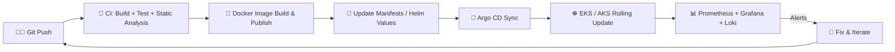

<div align="center">


<a href="https://github.com/yogesh-softradix">
  
</a>

<br/>


[](https://github.com/yogesh-softradix)
[](mailto:its.yogesh.23@gmail.com)

</div>

---

## 🖥️ `whoami`

```bash
$ whoami
yogesh-sharma

$ cat /etc/profile
role        : DevOps Engineer
focus       : Cloud | Kubernetes | CI/CD | GitOps | IaC
clouds      : AWS, OCI, Azure-connected environments
mission     : Automate deployments. Improve reliability. Reduce toil.
status      : always learning, always shipping 🚀

$ uptime
Running since Nov 2023 (training) -> DevOps Engineer (Jul 2025 - Present)
```

I build automated deployment workflows, manage cloud infrastructure, and improve application reliability through containerization, GitOps, and observability.

---

## ⚡ What I Do

<table>
<tr>
<td width="50%" valign="top">

### ☁️ Cloud & Infra
Provisioning and managing infrastructure on **AWS**, **OCI** and Azure-connected setups, from VPCs and subnets to EKS clusters and managed databases.

</td>
<td width="50%" valign="top">

### 📦 Containers & K8s
Containerizing apps with optimized multi-stage Dockerfiles and running them on **EKS** and **AKS** with **Helm**.

</td>
</tr>
<tr>
<td width="50%" valign="top">

### 🔄 CI/CD & GitOps
Automated build, test and deploy pipelines with **GitHub Actions**, **GitLab CI**, **Jenkins** and **Argo CD**.

</td>
<td width="50%" valign="top">

### 📊 Observability
Dashboards, logs and alerts with **Prometheus**, **Grafana**, **Loki**, **Alloy** and **CloudWatch**.

</td>
</tr>
</table>

---

## 🧰 Tech Arsenal

<div align="center">


<br/>


</div>

<br/>

| Area | Technologies |
|---|---|
| ☁️ **Cloud Platforms** | AWS (EC2, EKS, S3, IAM, CloudWatch, VPC, Route 53), Oracle Cloud Infrastructure (OCI) |
| ☸️ **Containers & Orchestration** | Docker, Kubernetes, Amazon EKS, Azure AKS, Helm |
| 🔄 **CI/CD & GitOps** | GitHub Actions, GitLab CI, Jenkins, Argo CD |
| 🏗️ **Infrastructure as Code** | Terraform |
| 🌐 **Web Servers & Process Mgmt** | Nginx, Apache, PM2 |
| 📊 **Monitoring & Logging** | Prometheus, Grafana, Loki, Grafana Alloy, Promtail, CloudWatch |
| 🗄️ **Databases** | MySQL, PostgreSQL, Amazon RDS |
| 🧬 **Version Control** | Git, GitHub, GitLab |
| 🐧 **Scripting & Systems** | Linux, Bash, server administration, networking, DNS, SSL/TLS |

---

## 🔁 How I Ship: My Typical Delivery Flow



---

## 🚀 Projects & Hands-on Work

<details open>
<summary><b>☸️ Containerization & Kubernetes</b></summary>
<br/>

- Containerized **Node.js, Python, and React** applications using optimized Dockerfiles and multi-stage builds.
- Worked with Kubernetes **Deployments, Services, Ingress, ConfigMaps, Secrets, and autoscaling**.
- Deployed workloads to **EKS and AKS** environments.

</details>

<details open>
<summary><b>🔄 CI/CD Pipeline Automation</b></summary>
<br/>

- Built and maintained pipelines with **GitHub Actions** and **GitLab CI** for automated build, test, and deployment.
- Worked with GitHub-hosted and **self-hosted runners**.
- Integrated static code analysis, unit testing, and Docker image publishing into pipelines.
- Created **Jenkins** pipelines for staging and production deployments, including rolling updates.

</details>

<details open>
<summary><b>🏗️ Terraform & Cloud Infrastructure</b></summary>
<br/>

- Provisioned cloud infrastructure and **EKS clusters** with modular Infrastructure as Code practices.
- Worked with compute instances, storage, networking, subnets, and cloud database resources.
- Set up **secure cross-cloud connectivity** between a private PostgreSQL database on OCI and an Azure environment through a **VPN tunnel**.

</details>

<details open>
<summary><b>🔀 Argo CD & GitOps</b></summary>
<br/>

- Set up declarative, Git-based deployment workflows for Kubernetes environments.
- Worked with Argo CD **sync waves, project RBAC, and automated image updates**.

</details>

<details open>
<summary><b>📊 Monitoring & Observability</b></summary>
<br/>

- Built monitoring and logging stacks using **Prometheus, Grafana, Loki, and Promtail**.
- Created dashboards for application performance, server metrics, logs, and deployment health.
- Configured alerts for resource spikes, pod failures, and deployment issues.

</details>

<details open>
<summary><b>🌐 Website Hosting & Reverse Proxy</b></summary>
<br/>

- Hosted WordPress and custom web applications using **Apache and Nginx**.
- Deployed Node.js applications with Apache ProxyPass and **PM2**.
- Configured SSL certificates with **Certbot** and automated server tasks with **Bash scripts**.

</details>

---

## 📈 GitHub Stats

<div align="center">


<br/>


</div>

---

## 💼 Journey

```text
2023 ──●── Nov 2023 – Apr 2024 : DevOps Training
        │
2024 ──●── May 2024 – Jun 2025 : DevOps Intern
        │
2025 ──●── Jul 2025 – Present  : DevOps Engineer  ← you are here 📍
```

| Role | Period |
|---|---|
| 🧑‍💻 **DevOps Engineer** | July 2025 – Present |
| 🛠️ **DevOps Intern** | May 2024 – June 2025 |
| 🎓 **DevOps Training** | November 2023 – April 2024 |

---

## 📚 Education

🎓 **Diploma in Electrical Engineering**
Government Polytechnic College, Nanakpur, Haryana
*February 2019 – February 2023*

---

## 🎯 Currently Levelling Up

- [ ] ☸️ Kubernetes operations, scaling, and troubleshooting
- [ ] 🧱 Secure and reusable Terraform modules
- [ ] 🔧 CI/CD reliability and deployment automation
- [ ] 🔀 GitOps workflows and release engineering
- [ ] 📊 Cloud monitoring, logging, and incident troubleshooting
- [ ] 🔐 DevSecOps and repository security scanning

---

## 🤝 Let's Connect

I'm open to talking about DevOps, cloud, Kubernetes, CI/CD and GitOps. Drop a message anytime!

<div align="center">

[](mailto:its.yogesh.23@gmail.com)
[](https://github.com/yogesh-softradix)

<br/>

> *"If you have to do it twice, automate it."* ⚙️

<br/>

**Automate deployments. Build resilient infrastructure. Keep learning.** 🚀


</div>
